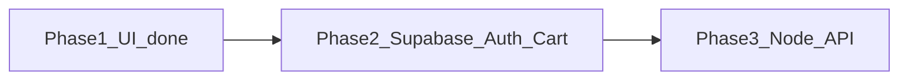

# Phase 2 — Auth + Supabase + cart merge (до Phase 3)

**Мета:** залогінений користувач має акаунт і кошик у Supabase; guest лишається на `localStorage` до login; після login/register — merge за правилами з [`docs/architecture.md`](docs/architecture.md) §5.1.

**Phase 3 (наступний):** Node.js API — contact form, валідація, admin, секрети. **Не робити в Phase 2.**

**Дипломні docs** — можуть почекати.



---

## Pre-flight (5–15 хв, якщо ще не зроблено)

Phase 1 достатньо закритий для старту (`CartLine`, `CartContext`, catalog). Дороби за бажанням:

- Empty state на [`Cart.tsx`](web/src/pages/Cart.tsx) якщо `cartItems.length === 0`
- Checkout button → disabled + «Coming soon»
- [`web/README.md`](web/README.md) — галочки Phase 1

Не блокує Phase 2.

---

## P2.1 — Supabase project + env

**Результат:** локально або hosted Supabase project, ключі в `.env`, клієнт підключається.

### Підтаски
1. Створити проєкт на [supabase.com](https://supabase.com) (або `supabase init` для local — обери **один** шлях на Phase 2).
2. У [`web/`](web/) додати `.env.example`:
   - `VITE_SUPABASE_URL`
   - `VITE_SUPABASE_ANON_KEY`
3. `.env` у `.gitignore` (не комітити секрети).
4. Встановити `@supabase/supabase-js`.
5. Файл `web/src/lib/supabaseClient.ts` — один експорт клієнта.

**Перевірка:** у консолі немає помилки підключення; `supabase.auth.getSession()` повертає null для guest.

---

## P2.2 — Мінімальна схема БД (тільки під auth + cart)

**Результат:** таблиці в Supabase SQL Editor; RLS увімкнено.

З [`docs/databaseshema.txt`](docs/databaseshema.txt) для Phase 2 потрібен **мінімум**:

| Таблиця | Навіщо |
|---------|--------|
| `profiles` | id = auth.users.id, first_name, phone, role (default `DefaultUser`) |
| `personal_carts` | 1 row на user (`user_id` unique) |
| `cart_items` | cart_id, product_id (поки string/id з mock), quantity |

**Поки catalog лишається в `data.json`** — у `cart_items.product_id` зберігай `id` з JSON (number/string). Пізніше заміниш на UUID з таблиці `items`.

### RLS (обов’язково)
- `profiles`: user читає/оновлює **лише свій** рядок
- `personal_carts` + `cart_items`: user бачить/змінює **лише свій** cart

**Не робити зараз:** повний catalog в DB, admin upload, orders.

**Перевірка:** в Supabase Table Editor видно таблиці; anon key з браузера **не** читає чужі cart rows.

---

## P2.3 — Auth UI (сторінки + стан сесії)

**Результат:** register / login / logout працюють через Supabase Auth.

### Маршрути (додати в [`App.tsx`](web/src/App.tsx))
| Path | Сторінка |
|------|----------|
| `/login` | Login |
| `/register` | Register |
| `/account` | Profile (optional v2) |

### Підтаски
1. **`AuthProvider`** (або розширити існуючий context): `user`, `session`, `loading`, `signIn`, `signUp`, `signOut`.
2. Сторінки Login / Register — форма email + password (стиль як Contact, [`site.css`](web/src/styles/site.css)).
3. Header: якщо guest — «Sign in»; якщо logged in — email/avatar + «Log out».
4. Protected route (опційно): `/account` тільки для logged-in; redirect на `/login`.

**Паролі** — тільки Supabase Auth, не в `profiles`.

**Перевірка:** register → confirm (якщо email confirm увімкнено) → login → header показує logged-in стан → logout → guest.

---

## P2.4 — Profile після реєстрації

**Результат:** після signUp створюється рядок у `profiles`.

### Підходи (обери один)
- **Database trigger** on `auth.users` insert → insert into `profiles` (рекомендовано для навчання)
- Або після signUp у клієнті — insert у `profiles`

Поля: ім’я (з форми register), email (з auth), `role = DefaultUser`.

**Перевірка:** новий user має row у `profiles`.

---

## P2.5 — Dual cart: guest vs logged-in

**Результат:** логіка кошика залежить від auth state.

| Стан | Джерело кошика | Add / Remove |
|------|----------------|--------------|
| Guest | `localStorage` (`cartItems`) — як зараз | [`cartContext.jsx`](web/src/context/cartContext.jsx) |
| Logged-in | Supabase `cart_items` | read/write через supabase client + RLS |

### Підтаски
1. Рефактор [`cartContext.jsx`](web/src/context/cartContext.jsx):
   - якщо `!user` → поточна localStorage логіка
   - якщо `user` → fetch cart з Supabase при login; `toggleCart` → upsert/delete у `cart_items`
2. Header badge `cartCount` — з того ж джерела.
3. [`Cart.tsx`](web/src/pages/Cart.tsx) + [`CartLine.tsx`](web/src/components/ItemCard/CartLine.tsx) — без змін UI, лише дані з context.

**Перевірка (logged-in):** Add → F5 → cart лишається (з БД, не localStorage).

---

## P2.6 — Merge guest cart після login/register

**Результат:** implement §5.1 з architecture.

Алгоритм (псевдокод):
```
onAuthSuccess:
  guestItems = read localStorage cartItems
  if guestItems empty → load DB cart only
  else:
    for each guestItem:
      if same product_id in DB cart → quantity += guest qty (or sum if qty=1 each)
      else → insert new cart_item
    clear localStorage cartItems
  refresh cart state from DB
```

**Конфлікт:** sum quantities (вже зафіксовано в architecture).

**Перевірка:**
1. Guest додає 2 товари → login → обидва в DB cart, localStorage порожній
2. Guest + user вже мав той самий товар → одна line, quantity збільшилась

---

## P2.7 — Polish Phase 2 + README

**Результат:** можна показати «Phase 2 demo».

- Помилки auth (wrong password) — user-friendly message
- Loading states на cart fetch
- [`web/README.md`](web/README.md) — секція Phase 2:
  - Supabase Auth
  - Guest cart localStorage / user cart DB
  - Merge on login
- `npm run build` проходить (env vars для Netlify — додати в dashboard)

**Не робити:** Node API, contact submit to backend, payment, admin panel.

---

## Definition of Done — Phase 2 (перед Phase 3)

- [ ] Supabase project + env + client
- [ ] `profiles`, `personal_carts`, `cart_items` + RLS
- [ ] Login / Register / Logout UI
- [ ] Guest cart = localStorage (як зараз)
- [ ] Logged-in cart = Supabase, persists after F5
- [ ] Merge localStorage → DB on login (sum qty on conflict)
- [ ] Header reflects auth + cart count
- [ ] Без Node `api/` folder logic yet

---

## Після Phase 2 → Phase 3 (Node API)

Тоді додаси:
- `api/` Express/Fastify
- Contact form → api → email або Supabase table
- Service role key **тільки на server**
- Docker Compose `web` + `api`

Catalog у Supabase (`items` table) можна переносити **або** в Phase 3 **або** окремим кроком — не блокує старт API, якщо cart уже в DB.

---

## Рекомендований порядок (ти робиш, AI — hints)

1. P2.1 env + client  
2. P2.2 SQL schema + RLS  
3. P2.3 Auth UI  
4. P2.4 profiles trigger  
5. P2.5 dual cart  
6. P2.6 merge  
7. P2.7 polish  

Почни з **P2.1**: «підказка по Supabase client у Vite» — якщо learning mode.
