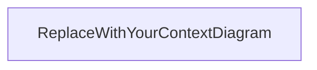

# System Architecture — TNDC Jewelry House

> Decisions below reflect choices already made by the student.
> Remaining sections stay open until filled during later workshop steps.

## 1. Problem statement & scope

**Product:** family jewelry e-commerce site (TNDC Jewelry House).

**Actors (v1):** guest shopper; registered customer (after sign-up/login); shop owner/admin (later for catalog management).

**In scope (v1):**
- Catalog browsing, categories, new arrivals
- Cart without payment
- Contact form
- About + location
- Layered architecture, Docker (web + api), design system

**Out of scope (v1):**
- Online payment (planned for later versions)
- Full CRM (order confirm/cancel may come later via email/CRM)

## 2. Context diagram

<!-- Still to draw: browser, web, api, Supabase, email -->

## 3. Containers

| Container | Responsibility | Depends on |
|-----------|----------------|------------|
| Next.js / React `web` | UI, routing | api, Supabase (as decided per feature) |
| Node.js `api` | Business rules, validation | Supabase, email later |
| Supabase | Postgres, Auth, Storage | — |

Exact wiring and rationale — continue in workshop sections B–C.

## 4. Responsibility matrix

<!-- Continue refining owners in architecture-workshop.md section D -->

| Concern | Owner |
|---------|-------|
| Catalog read | TBD |
| Images | Supabase Storage (admin upload only) |
| Cart (guest) | client — `localStorage` |
| Cart (logged-in) | database (`PersonalCart` + line items) |
| Contact form | TBD (UI + backend validation) |
| i18n content | TBD (PL / EN / UK) |

## 5. Data model

See also [`databaseshema.txt`](./databaseshema.txt).

### 5.1 Cart rules (decided)

1. **Guest (not registered):** cart lives only in the browser **`localStorage`**. No guest cart rows in the database.
2. **After registration / login:** **migrate (merge)** the guest cart from `localStorage` into the user’s **`PersonalCart`** in the database.
3. **Logged-in user:** cart persists in the DB under that user’s id so they can return to it across sessions/devices (while logged in).
4. **Merge conflict:** if the same item exists in both guest `localStorage` and the user’s DB cart, **sum the quantities** into one line, then clear the guest cart from `localStorage`.
5. Clearing site data / `localStorage` as a guest loses the guest cart — that is acceptable because guest data was never stored in the DB.

### 5.2 Auth & profile (decided)

- Passwords are **not** stored in `UserData`.
- Authentication uses **Supabase Auth** (hashing/sessions handled by Supabase).
- `UserData` holds profile fields (name, phone, email, …) linked to the auth user.
- Roles: `Owner`, `Admin`, `DefaultUser` (see `RoleTable` in schema sketch).

### 5.3 Entities (sketch)

- `UserData`, `RoleTable`, `PersonalCart`, `CartItem` (line), `Items`, `ItemsCategory`
- Catalog `Items` are shared; cart holds **references** + quantity, not ownership of products
- i18n for product text (PL/EN/UK) and image fields — still to detail in schema

## 6. Key sequences

### 6.1 Browse → cart

- Guest: add/update cart in `localStorage` (sync UX).
- Logged-in: add/update cart in DB.
- On login/register: run merge from `localStorage` → DB, then clear `localStorage` cart.

### 6.2 Contact form

Client submits message + contact email; shop owner can reply by email (e.g. Gmail). Containers/failure cases still to specify.

### 6.3 Optional: order / inquiry

Cart may collect delivery info; request sent to shop owner by email/CRM later. Payment out of v1.

## 7. Routing map (Next.js App Router)

| Page | Path | Notes |
|------|------|-------|
| Home | `/` | New arrivals |
| Categories | `/categories` | Listing / filters |
| Product | `/products/[slug]` | Later |
| Cart | `/cart` | Guest: localStorage; user: DB |
| About | `/about` | |
| Contact | `/contact` | |

Early UI may use Vite + React Router; production target remains Next.js App Router.

## 8. Docker & environments

**Decided direction:**
- Compose services: `web`, `api`
- Supabase: full local Supabase for development (decision from workshop)
- `.env` — gitignored (real secrets)
- `.env.example` — committed (variable **names** only, no secrets)

**Deferred until Docker implementation block:**
- Exact host ports
- Full env var name list
- How local Supabase is started alongside Compose

Do not invent port numbers until that phase.

## 9. Security & testing notes

- Roles for authorization (`DefaultUser` vs `Admin` / `Owner`)
- Validation: backend required; minimal checks on frontend
- Product image upload: admin only (not clients)
- Tests: unit tests as baseline; broaden later if needed for diploma

## 10. Open questions

- Full context diagram and final responsibility matrix (workshop B–D)
- i18n storage strategy (JSON vs translation table)
- Contact/order persistence tables
- Docker ports and env names (deferred by choice)
