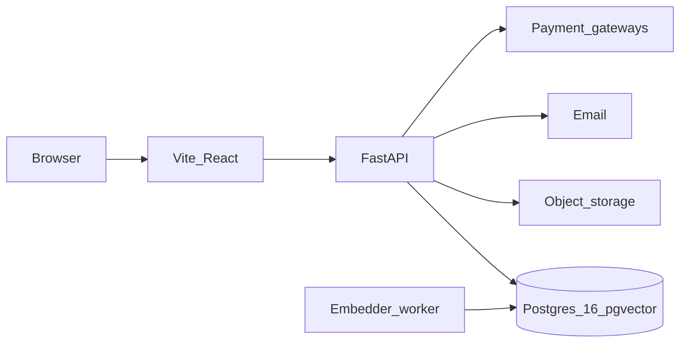

# System Architecture — TNDC Jewelry House

> Decisions below reflect choices already made by the student.
> Remaining sections stay open until filled during later workshop steps.

## 1. Problem statement & scope

**Product:** family jewelry e-commerce site (TNDC Jewelry House).

**Actors (v1):** guest shopper; registered customer (after sign-up/login); shop owner/admin (later for catalog management).

**In scope:**
- Catalog browsing, categories, new arrivals
- Cart (guest in the browser, logged-in in Postgres)
- Orders and sandbox payments for the UA and PL markets (later milestone; the current UI does not charge cards)
- Contact form, about, location
- Own authentication, two languages (`uk`, `pl`), semantic search
- Layered architecture, Docker (`web`, `api`, `postgres`)

**Out of scope:**
- Storing card numbers (PCI data stays at the payment gateway)
- Full CRM

## 2. Context diagram

The browser talks only to the Vite storefront. The storefront calls FastAPI. FastAPI is the only component that opens Postgres. An embedder worker writes vectors. Email and payment gateways stay outside the trust boundary.

## 3. Containers

| Container | Responsibility | Depends on |
|-----------|----------------|------------|
| Vite + React `web` | UI, client routing | api |
| FastAPI `api` | Business rules, auth, validation, recommendations | Postgres, object storage, email later |
| PostgreSQL 16 + pgvector | Catalog, carts, orders, embeddings | — |
| Object storage | Product images | — |

Supabase is optional later as managed Postgres/storage for production. It is not the auth provider and the browser does not talk to the database. See D1–D2.

Exact wiring and rationale — continue in workshop sections B–C.

## 4. Responsibility matrix

<!-- Continue refining owners in architecture-workshop.md section D -->

| Concern | Owner |
|---------|-------|
| Catalog read | TBD |
| Images | Supabase Storage (admin upload only) |
| Cart (guest) | client — `localStorage` |
| Cart (logged-in) | database (`PersonalCart` + line items) |
| Contact form | TBD (UI + backend validation) |
| i18n content | TBD (PL / EN / UK) |

## 5. Data model

Logical model: [`schema.dbml`](./schema.dbml).

Diagrams for the database-design chapter:

- [schema.svg](./diagrams/schema.svg)
- [schema.png](./diagrams/schema.png)

[`databaseshema.txt`](./databaseshema.txt) is the earlier sketch (Supabase Auth, no markets). D1–D5 replace that sketch. Milestone 1 turns `schema.dbml` into migrations.

### 5.1 Cart rules (decided)

1. **Guest (not registered):** cart lives only in the browser **`localStorage`**. No guest cart rows in the database.
2. **After registration / login:** **migrate (merge)** the guest cart from `localStorage` into the user’s **`PersonalCart`** in the database.
3. **Logged-in user:** cart persists in the DB under that user’s id so they can return to it across sessions/devices (while logged in).
4. **Merge conflict:** if the same item exists in both guest `localStorage` and the user’s DB cart, **sum the quantities** into one line, then clear the guest cart from `localStorage`.
5. Clearing site data / `localStorage` as a guest loses the guest cart — that is acceptable because guest data was never stored in the DB.

### 5.2 Auth & profile (decided — D1)

- Passwords are stored only as a **hash** on `users` (`password_hash`). The application hashes them (argon2id or bcrypt). No plaintext passwords.
- Authentication is implemented in **FastAPI** (access JWT + rotating refresh tokens). Not Supabase Auth.
- `user_profiles` holds profile fields (phone, language, market, consent) linked to `users`.
- Roles: `User`, `Manager`, `Admin`.
- The React `authContext` is a stub with no network calls until Milestone 2.

### 5.3 Entities

- `users`, `user_profiles`, `refresh_tokens`
- `markets`, `exchange_rates`, `shipping_methods`, `variant_prices`
- `categories`, `products`, `product_translations`, `product_variants`, `product_images`, `gemstones`, `product_gemstones`
- `product_embeddings` (`vector(384)`, `model_name`, `locale`)
- `carts`, `cart_items`, `user_addresses`, `orders`, `order_items`, `payments`
- The catalog is shared. A cart line references a **variant** and a quantity. It does not own the product.
- Product text for `uk` and `pl` lives in `product_translations` (D4). English is optional.

## 6. Key sequences

### 6.1 Browse → cart

- Guest: add/update cart in `localStorage` (sync UX).
- Logged-in: add/update cart in DB.
- On login/register: run merge from `localStorage` → DB, then clear `localStorage` cart.

### 6.2 Contact form

Client submits message + contact email; shop owner can reply by email (e.g. Gmail). Containers/failure cases still to specify.

### 6.3 Optional: order / inquiry

Cart may collect delivery info. A later milestone creates an order and starts a sandbox payment for the active market. Card data is not stored here.

## 7. Routing map (Vite + React Router)

| Page | Path | Notes |
|------|------|-------|
| Home | `/` | New arrivals |
| Categories | `/categories` | Listing / filters |
| Product | `/products/:slug` | Later |
| Cart | `/cart` | Guest: localStorage; user: DB |
| About | `/about` | |
| Contact | `/contact` | |
| Login | `/login` | Stub page until Milestone 2 |
| Register | `/register` | Stub page until Milestone 2 |
| Account | `/account` | Stub page until Milestone 2 |

The diploma frontend stays **Vite + React + React Router**. There is no Next.js migration.

## 8. Docker & environments

**Decided direction:**
- Compose services: `web`, `api`, `postgres` (Postgres 16 image with pgvector)
- Supabase: not required for local development (D2). Optional later as managed Postgres/storage
- `.env` — gitignored (real secrets)
- `.env.example` — committed (variable **names** only, no secrets)

**Deferred until Docker implementation block:**
- Exact host ports
- Full env var name list
- How local Supabase is started alongside Compose

Do not invent port numbers until that phase.

## 9. Security & testing notes

- Roles for authorization (`DefaultUser` vs `Admin` / `Owner`)
- Validation: backend required; minimal checks on frontend
- Product image upload: admin only (not clients)
- Tests: unit tests as baseline; broaden later if needed for diploma

## 10. Open questions

- Final responsibility matrix (workshop section D) still has TBD owners for catalog read and the contact form
- Whether a cart is repriced or replaced when the shopper switches market mid-session
- Whether PLN prices are entered by hand or proposed from `exchange_rates` and then overridden
- Docker ports and env var names (deferred until the Compose milestone)

## 11. Decisions D1–D5

Recorded before backend work. They override the earlier Node.js + Supabase Auth direction.

**D1. Authentication is implemented in FastAPI, not Supabase Auth.**
`users.password_hash`, lockout fields, and refresh tokens mean the application owns credentials. Consequences: the browser calls `/auth/login` and `/auth/refresh`; the API is the only database client; row-level security is not the security boundary; hashing, token rotation, and account lockout are our responsibility.

**D2. The development database is Postgres 16 with pgvector in Docker Compose.**
Supabase may still be a managed Postgres (and file storage) in production. Local Postgres keeps the project offline, keeps migrations real, and keeps the vector extension under our control.

**D3. Two markets. Ukraine is primary, Poland is second.**
Ukraine: UAH, locale `uk`, Nova Poshta, Monobank/LiqPay. Poland: PLN, locale `pl`, Polish banks and delivery (Przelewy24/PayU, BLIK, InPost). The defence is at a Polish university, so the Polish market is a shipped feature. A `markets` row binds currency, locale, carriers, payment providers, and tax. `exchange_rates` are required. Prices for sale live in `variant_prices`, per currency.

**D4. Translations use `product_translations`.**
`products` does not store a single name/description. Minimum locales are `uk` and `pl`. English is optional. Those texts are also the input for semantic search.

**D5. Embeddings use `multilingual-e5-small`, 384 dimensions, with the model version stored.**
`product_embeddings.embedding` is `vector(384)`. `model_name` and `locale` are part of the key so two models or two languages can be compared.

The browser never opens a database connection. Pages call the FastAPI services; those services read and write Postgres.
